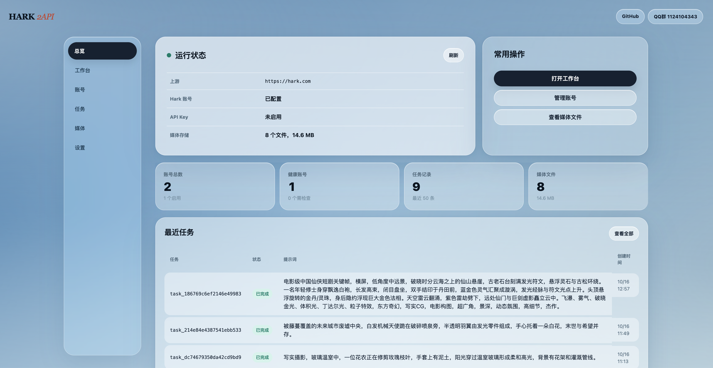
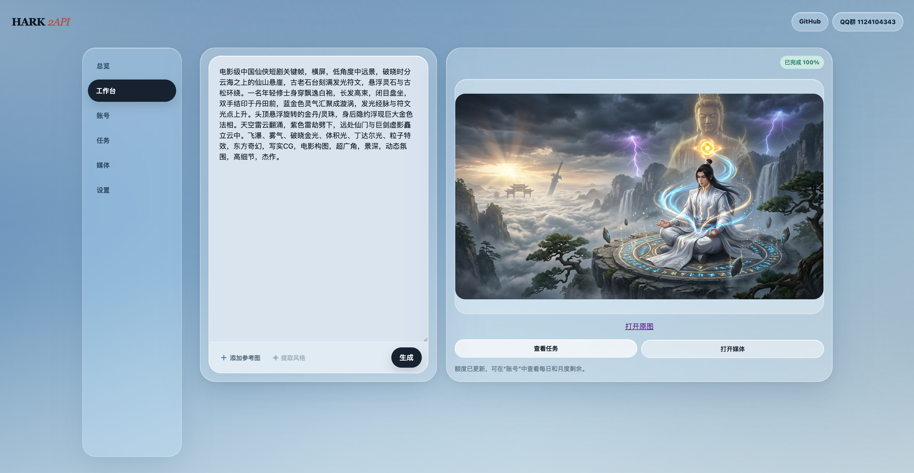
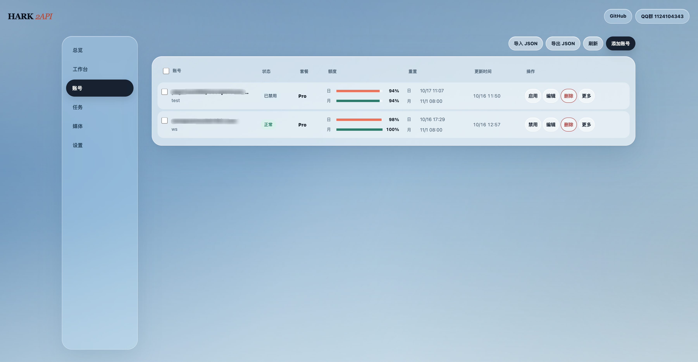
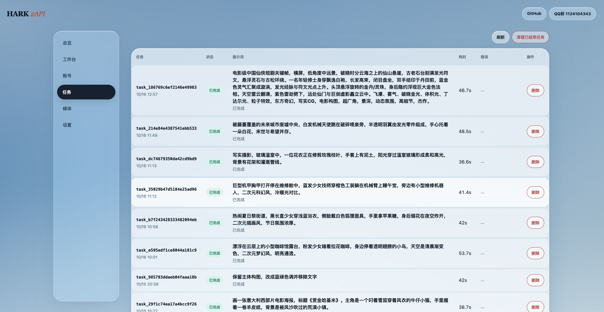
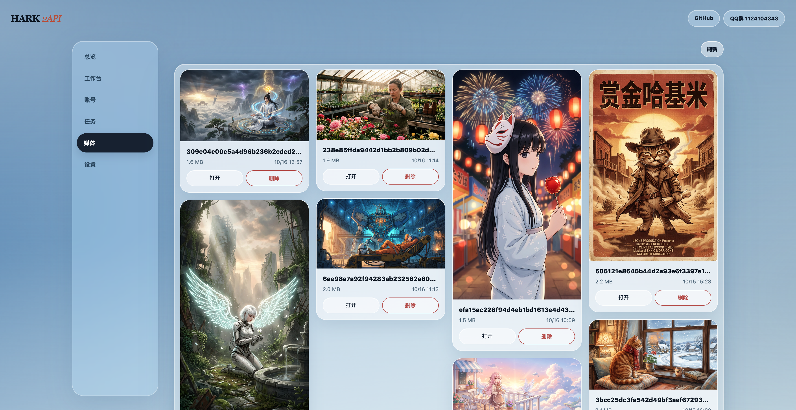
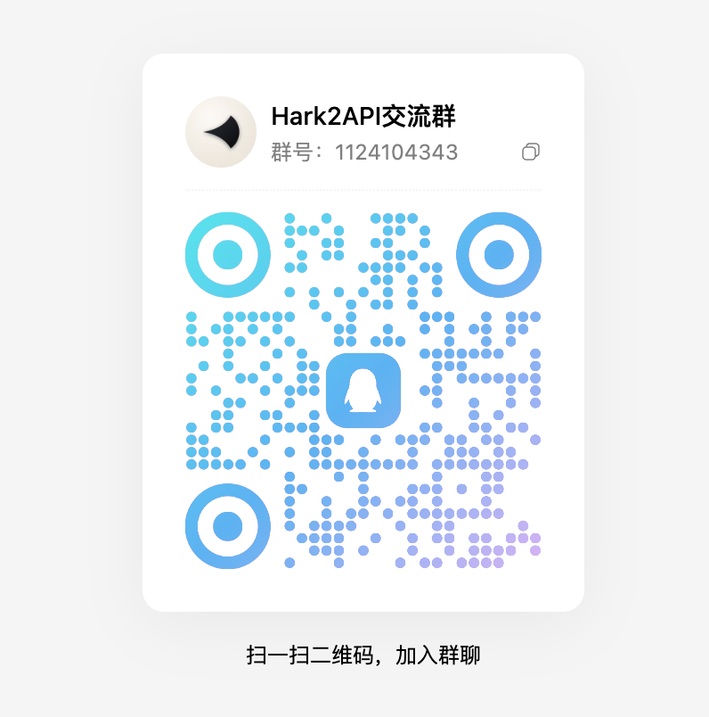

# hark2api

<p align="center">
  <strong>一个功能完整的 OpenAI 兼容 API 服务，为 Hark 提供统一的接口</strong>
</p>

<p align="center">
  <a href="https://github.com/jyao0708/hark2api"></a>
  
  
  
  <a href="LICENSE"></a>
</p>

> [!WARNING]
> 仅建议用于个人学习、研究和自托管。请遵守 Hark 的使用条款及当地法律法规。Cookie、API Key 和账号导出文件都是敏感凭据，不要提交到 Git 或公开分享。

## 它是什么

`hark2api` 是一个轻量的本地 API 网关：使用已登录的 Hark 会话调用文本、图片和图片编辑能力，并提供一个 Web 控制台管理账号、任务和媒体文件。

## 界面预览

<p align="center">
  
</p>

<p align="center">
  
</p>

<table>
  <tr>
    <td width="50%"></td>
    <td width="50%"></td>
  </tr>
  <tr>
    <td align="center">账号管理</td>
    <td align="center">任务记录</td>
  </tr>
</table>

<p align="center">
  
</p>

<p align="center">媒体库</p>

## 当前支持

| 能力 | 接口 | 说明 |
| --- | --- | --- |
| 文本对话 | `/v1/chat/completions` | 支持普通响应和 SSE 流式响应 |
| Responses API | `/v1/responses` | 支持文本输入和流式响应 |
| 文生图 | `/v1/images/generations` | 支持 URL、Base64 和异步任务 |
| 图片编辑 | `/v1/images/edits` | `multipart/form-data`，每次一张参考图 |
| 异步图片任务 | `/v1/images/tasks` | 支持轮询、持久化和 `Idempotency-Key` |
| 模型列表 | `/v1/models` | 返回当前可用的 Hark 模型入口 |
| 媒体访问 | `/v1/media/{filename}` | 为生成结果提供本地访问地址 |

Hark 目前不是常规的视频生成模型，所以项目不提供 `/v1/videos`。Hark 返回的是阶段状态，项目只展示排队、等待响应、生成中和整理结果等真实阶段。

## 快速开始

### 本地运行

环境要求：Python 3.10 或更高版本。

```bash
git clone https://github.com/jyao0708/hark2api.git
cd hark2api

python3 -m venv .venv
source .venv/bin/activate
pip install -r requirements.txt
cp .env.example .env
```

编辑 `.env`，至少配置以下一种凭据来源：

```dotenv
# 完整 Cookie 请求头，或单独的 __Secure-hark.session_token
HARK2API_COOKIE=

# 也可以填入只允许当前用户读取的本地文件路径
HARK2API_COOKIE_FILE=
```

启动服务：

```bash
python -m uvicorn main:app --app-dir src --host 0.0.0.0 --port 18611
```

打开控制台：<http://127.0.0.1:18611/>

其他入口：
- Swagger 文档：<http://127.0.0.1:18611/docs>
- 健康检查：<http://127.0.0.1:18611/healthz>
- 就绪检查：<http://127.0.0.1:18611/readyz>

### Docker Compose

```bash
cp .env.example .env
# 编辑 .env 后执行
docker compose up -d --build
```

Compose 会把 `./data` 挂载到容器内的 `/app/data`，用于保存账号、任务和媒体文件。

## 常用配置

| 变量 | 默认值 | 用途 |
| --- | --- | --- |
| `HARK2API_KEY` | 空 | API 鉴权 Key；为空时不启用鉴权 |
| `HARK2API_COOKIE` | 空 | 完整 Cookie 或 session token |
| `HARK2API_COOKIE_FILE` | 空 | Cookie 文件路径，优先于 `HARK2API_COOKIE` |
| `HARK2API_UPSTREAM` | `https://hark.com` | Hark 上游地址 |
| `HARK2API_HOST` | `0.0.0.0` | 服务监听地址 |
| `HARK2API_PORT` | `18611` | 服务监听端口 |
| `HARK2API_PUBLIC_BASE` | 空 | 对外访问地址，反向代理部署时设置 |
| `HARK2API_CHAT_TIMEOUT` | `300` | 对话和图片请求超时秒数 |
| `HARK2API_TASK_QUEUE_LIMIT` | `8` | 未结束图片任务队列上限 |
| `HARK2API_MAX_MEDIA_BYTES` | `134217728` | 单个媒体文件大小上限 |

控制台设置页中的 API Key 只保存到当前浏览器的 `sessionStorage`，不会写入服务端文件。

## 社区交流

QQ群：**1124104343**

<p align="center">
  
</p>

## 许可证

本项目基于 [MIT License](LICENSE) 开源。Hark 及其相关商标和服务归其各自权利人所有，本项目与 Hark 官方没有隶属或背书关系。
